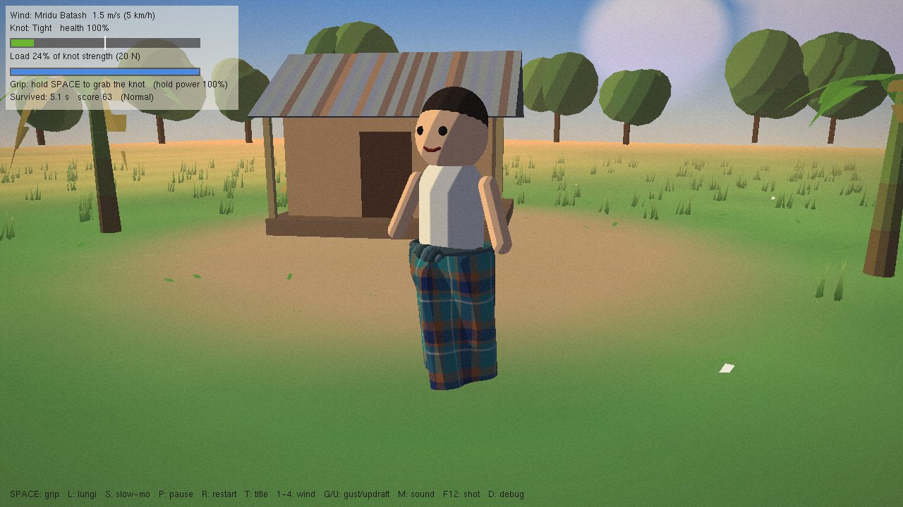
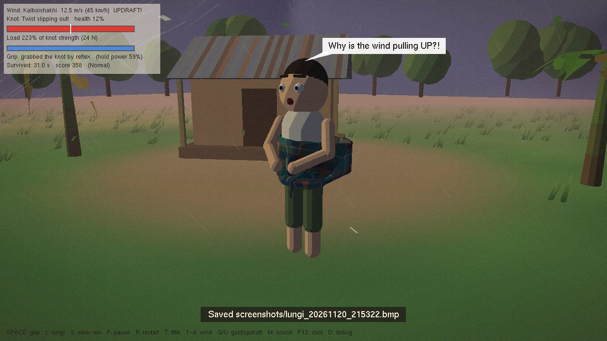

# Lungi Dynamics: A Kalboishakhi Survival Simulator

My individual project for CSE 402 (Computer Graphics & Image Processing Lab),
Metropolitan University, Sylhet.

A lungi, simulated as a cloth mesh, is worn by a simple character during a
Kalboishakhi storm. Wind and gravity pull on the cloth, and a simulated waist
knot holds until its load passes a threshold. You can also load a photo of real
lungi fabric, and my image-processing code turns it into the cloth texture.

## Status

Feature complete. Remaining work is testing on real lungi photos, the report
and the demo video.

The game starts on a title screen where I pick a difficulty and one of five
woven lungi patterns. The storm then builds up on its own, from a calm
Boishakh afternoon to Nor'wester Mode. Holding Space makes the character grab
the knot, which makes it 60% stronger, but grip stamina runs out, so it has to
be saved for the big gusts. When the knot gives up, a results screen shows the
Lungi Survival Score and a score tier.

The lungi is tied the Bangladeshi way: the extra cloth is gathered at the
front, the top edge is rolled into a band, and a double twist is tucked in.
When the knot is overloaded, the roll unrolls, the twist slips out and the
waistline slides down. The character wears three-quarter pants underneath.

### Photo Lab (image processing)

Press O on the title screen to open a photo of real lungi cloth. I select an area
with the mouse and my code (written by hand, no OpenCV) turns it into a lungi
texture:

1. Grayscale (Y = 0.299 R + 0.587 G + 0.114 B) and illumination normalisation
   (divide by a large box blur, computed with a summed-area table).
2. Row and column intensity profiles.
3. A Discrete Fourier Transform of each profile finds the repeat period, with a
   sub-harmonic check, parabolic peak refinement and a shift test that rejects
   false repeats (for example a rotated photo).
4. K-means (k-means++ start) finds the 2 to 4 main colours.
5. One repeat cell is resampled into a seamless tile (edge cross-fade) and
   snapped to those colours.

Every step is shown on screen. If no repeat is found, the program says so and
the repeat can be set by hand with the arrow keys. Results on synthetic test
photos are in `docs/ImageProcessingAccuracy.md` (24 of 25 correct). The photos
in `assets/fabrics/synthetic_*.jpg` are generated test images, not real photos.

### Holding on, and which way the lungi goes

The character grabs the knot by reflex when it strains, and holding Space is a
stronger two-hand grip that uses stamina. How much a grip helps depends on the
wind: full strength in a light breeze, falling to 15% in a Nor'wester
(hold power = (22 - wind) / (22 - 6), clamped to 0.15 - 1). In winds above
10 m/s the hands can be torn off the knot for a moment, more often the
stronger the wind.

Some gusts are thunderstorm updrafts (rising air). The wind model includes skin
friction along the cloth surface, so a strong updraft can lift the whole tube.
If the knot fails during an updraft, the lungi flies up over the character's
head; otherwise it drops past the legs. In my test runs it flew up in about a
quarter to a third of the games.

The character's face changes with the knot load (calm, worried, panic, shock),
the arms grab or flail, and a speech bubble shows Banglish and English lines.

### Village scene, storm and sound

The character stands in a village courtyard: a tin-roofed hut, banana trees
with torn leaves that sway with the wind, haystacks, grass, rice fields and a
line of trees fading into the distance. Everything uses the same two- or
three-tone toon ramp as the character. As the storm builds, the sky darkens,
clouds roll in, leaves and paper scraps blow past, rain falls in slanted
streaks and, in the strongest stage, lightning flashes with thunder a moment
later. A soft vignette and a light film grain give the hand-painted look.

Sounds: a looping wind that gets louder with the wind speed, rain that fades
in with the storm, gust whooshes, thunder, the knot popping, the lungi flying
off and the hands slipping. M mutes everything. Audio uses the Windows MCI API
(winmm), so several sounds can play at once.

### Score

Lungi Survival Score = (10 x seconds survived + 4 x strongest gust survived in
m/s - lungi displacement penalty) x difficulty multiplier (Easy 0.8, Normal 1.0,
Hard 1.3). Tiers: Lungi Newbie (below 300), Gaye Joth Ase (300+),
Kalboishakhi Warrior (430+), Lungi Legend (520+).

### Evaluation mode

Press E on the title screen. The program runs every combination of physics
time step (1/60, 1/120, 1/240 s) and wind preset (4) for 7.5 s each, about 90 s
in total, and writes `logs/evaluation_<date>_<time>.csv` with FPS, frame time,
physics time, maximum and mean cloth stretch, knot force and NaN recoveries.
Esc cancels it. Every normal game is also added to `logs/runs.csv`, and F12
saves a screenshot to `screenshots/`.

Position-Based Dynamics gets stiffer the more solver passes it does per
simulated second, so a longer time step gets proportionally more iterations
(1/60 s uses 30, 1/120 s and 1/240 s use 15). The CSV records the number used.
While the knot holds, a particle may move at most 5 cm in one step, and a
particle is always pushed out of a capsule on the side it came from, so the
cloth cannot tunnel through a leg. Results are in `docs/Evaluation.md`.

## Features

- Position-Based Dynamics cloth tube, 40 x 30 particles, with structural,
  shear and bending constraints and long-range tethers
- Capsule body collision with friction, and a waist knot that wears out and
  fails
- Gusting Kalboishakhi wind with storm stages and updrafts, drag on every
  triangle
- Five built-in woven patterns and photo-based pattern extraction
  (grayscale, normalisation, intensity profiles, DFT, k-means, seamless tile)
- Toon-shaded village scene, rain, lightning, HUD, Lungi Survival Score
- Sound effects and ambience
- Evaluation mode that logs FPS and stability to CSV

## Controls

| Key | Title screen | In the storm |
|-----|--------------|--------------|
| Enter | Start | - |
| E | Evaluation mode | - |
| Up / Down | Difficulty | Orbit camera |
| Left / Right | Lungi pattern | Orbit camera |
| Space | Start | Hold to grab the knot |
| L | Next lungi pattern | Next lungi pattern |
| O | Open the Photo Lab | - |
| S | - | Slow motion on / off |
| P | - | Pause |
| R | - | Restart the run |
| T / Esc | Quit (Esc) | Back to title |
| 1 / 2 / 3 / 4 | - | Sandbox: fix the wind preset |
| G / U / W | - | Send a gust / send an updraft / wind on-off |
| M | Sound on / off | Sound on / off |
| F12 | Screenshot | Screenshot |
| + / - | - | More / fewer solver iterations |
| D | Debug panel | Debug panel |
| F | Fullscreen | Fullscreen |
| Mouse drag / wheel | Camera | Camera |

## How to build (Code::Blocks + MinGW-w64)

1. Install Code::Blocks with MinGW-w64 (I use GCC 8.1, x86_64).
2. Open `LungiDynamics.cbp`.
3. Copy `third_party/freeglut/bin/libfreeglut.dll` into `bin/Debug/` and
   `bin/Release/` (create the folders if they do not exist). On my machine,
   `setup_freeglut.bat` does this step.
4. Choose the Debug or Release target and press F9 (Build and run).

FreeGLUT headers and the 64-bit import library are included in `third_party/`,
so no extra installation is needed.

## Folder layout

| Folder | Contents |
|--------|----------|
| `src/` | All source code |
| `third_party/` | FreeGLUT and stb_image |
| `assets/` | Textures, fabric photos, sounds |
| `docs/` | Report material, test results |
| `logs/` | Evaluation and game logs (created when needed) |
| `screenshots/` | F12 screenshots (created when needed) |

## Screenshots

## Photo Lab controls

| Key | Action |
|-----|--------|
| O | Open a photo (Windows file dialog) |
| Mouse drag | Select the fabric area |
| K | Number of colours: auto, 2, 3, 4 |
| Arrow keys | Adjust the repeat by hand (left/right across, up/down down) |
| A | Back to automatic repeat |
| Enter | Wear the fabric |
| Esc | Back to the title screen |

A photo can also be given on the command line: `LungiDynamics.exe photo.jpg`.

## Future work

This version runs on Windows desktop only. A web version and a mobile version
are planned as future work. I kept platform-specific code (file dialog, audio)
in separate files to make a later port easier.

## Credits

- FreeGLUT: windowing and input (MIT/X11-style licence).
- stb_image by Sean Barrett: image loading (public domain / MIT).
- Sounds: synthesised with `tools/make_sounds.py` (filtered noise and simple
  envelopes; needs Python with numpy and scipy:
  `python tools/make_sounds.py assets/sounds`). No third-party audio is used.
